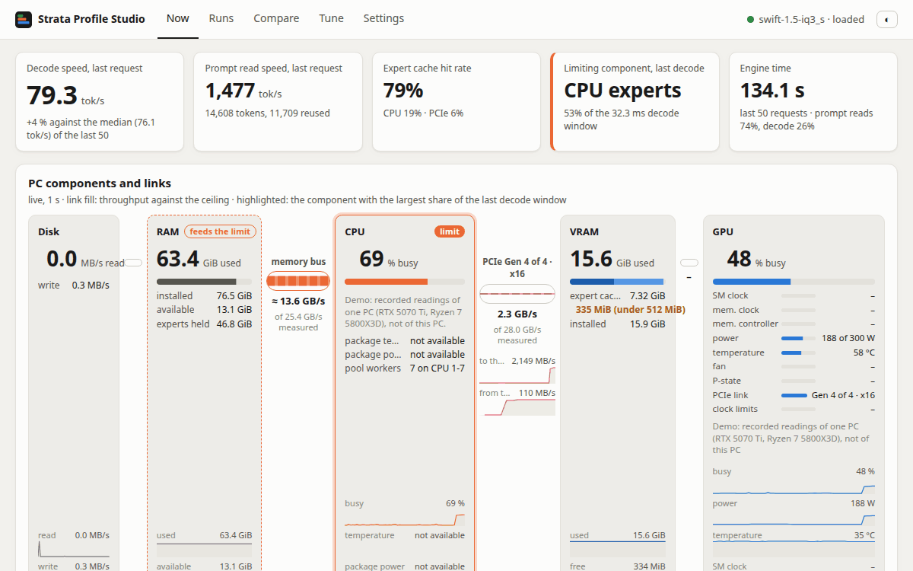
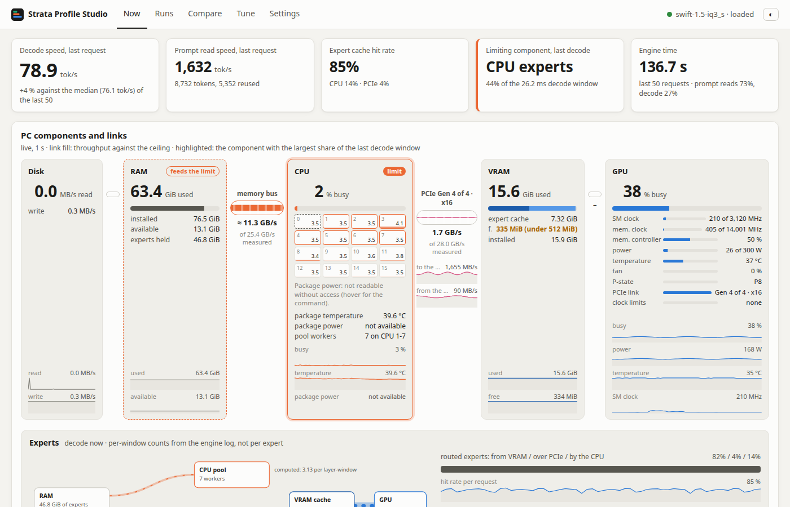
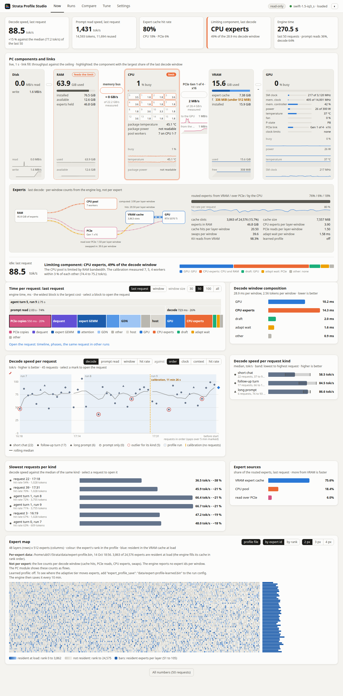
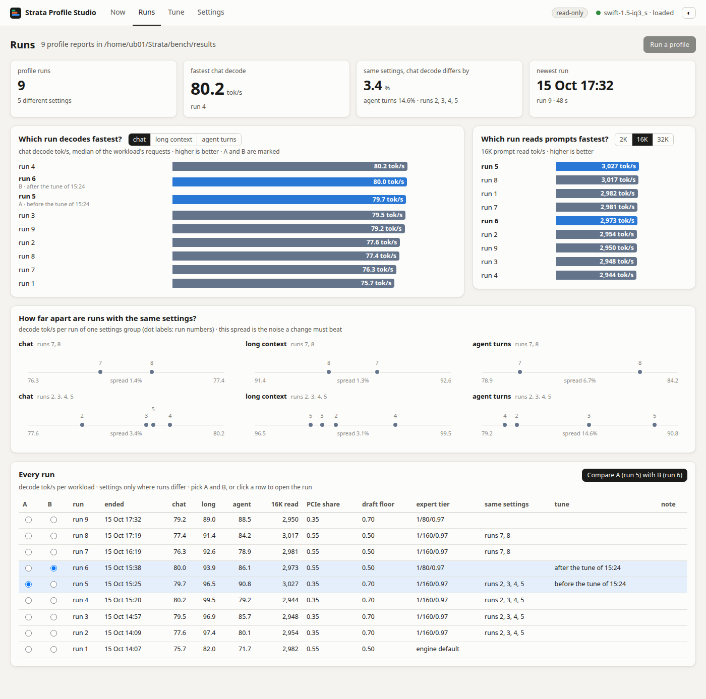
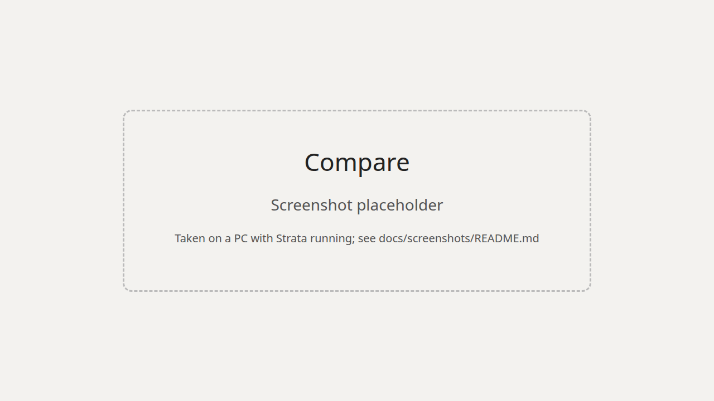
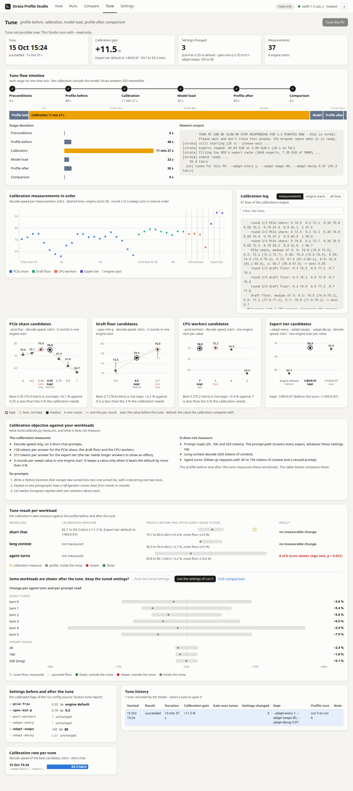
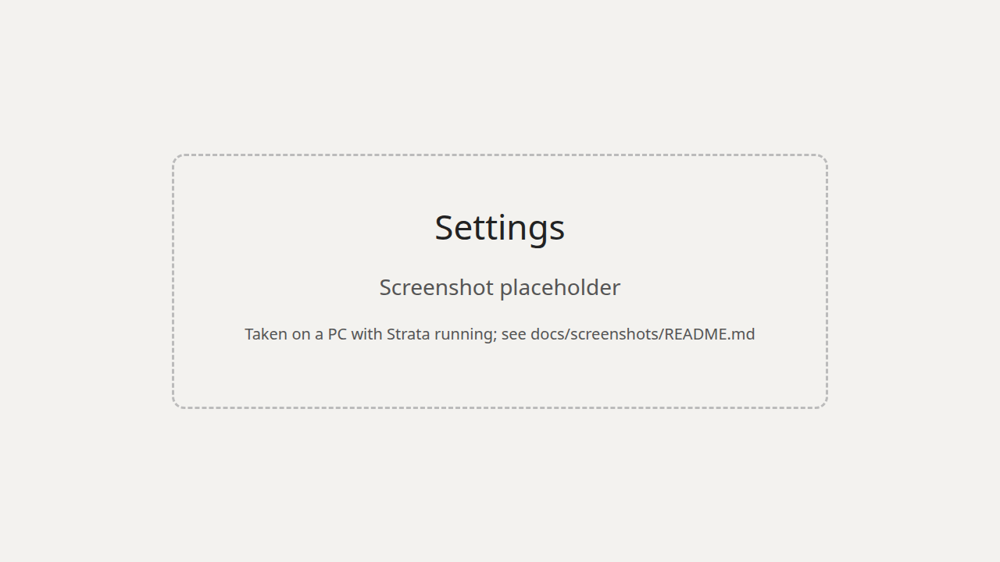
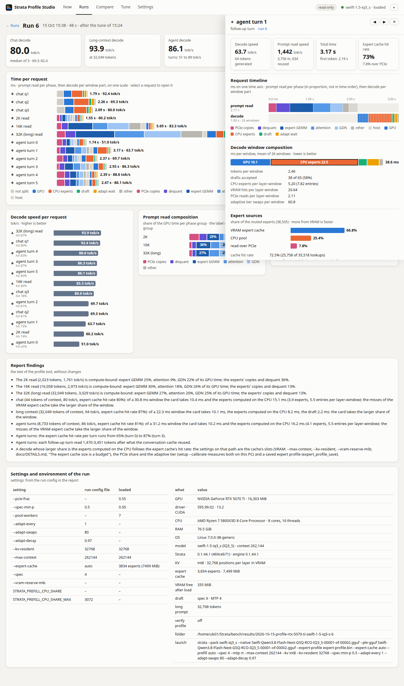
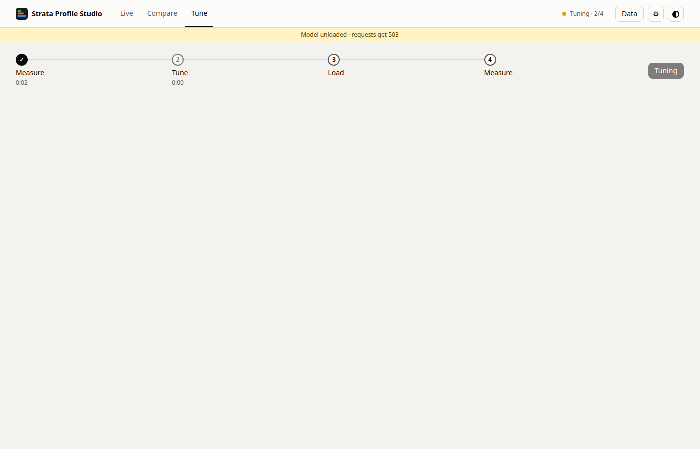
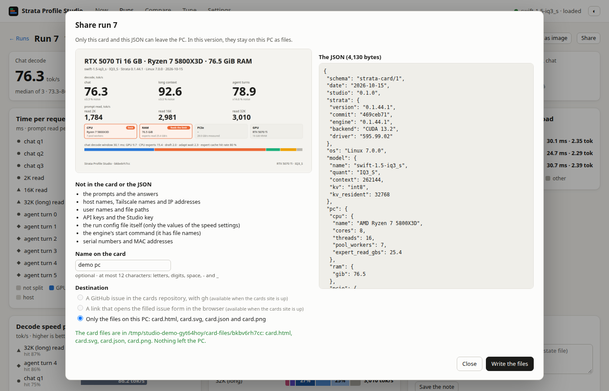

# Strata Profile Studio

**See what limits [Strata](https://github.com/Niko1221/Strata) on your PC, tune it, and measure whether the tune
helped.**


<sub>The tests on hardware ran on Linux with an NVIDIA card only. Windows, macOS and AMD use the readers from the
documentation of each tool. See [Works on](#works-on).</sub>



<sub>The tour shows the demo (`python3 studio.py --demo`). The same view as a still image:</sub>



The Studio is a web page. It shows where the time of each Strata request goes and which part of the PC limits it.
It also shows whether a change of settings made Strata faster, against the noise of this PC. It needs a running Strata on the
same PC and Python 3.11 or newer. It uses no GPU of its own, and it writes only Strata's run config (after a dialog,
with a `.bak` copy) and its own state file.

## Which Strata

- **Strata 0.1.44.1 as released (stock mode).** The Studio works with it. This build has no profile routes, so the
  Studio does that work itself. The Studio finds this out from Strata's answers. It needs no flag.
  - **Without anything more:** Now shows the speeds of each request from `/metrics`, and the PC module. Runs,
    Compare and Settings work.
  - **With the engine log:** the time per component of each request comes from the engine's timing lines. The
    components are the GPU, the CPU experts, the draft and PCIe. The engine writes them when the run config's `"env"` has
    `"STRATA_PREFILL_TIMING": "1"` and `"STRATA_DECODE_TIMING": "1"`. The **Timing lines** block on the Settings
    page adds the two switches (the other keys of `"env"` stay) and tells you to restart Strata. The Studio must be
    able to read the log (`"log"` in the run config). A Strata in another container or on another PC: speeds only.
  - **Run a profile** runs the Studio's copy of Strata's profile tool against the running server, with Strata's
    `tools/` from the Strata folder (or `--strata-root DIR`).
  - **Tune this PC** unloads the model through Strata's `/unload`, runs setup's calibration for the run config, and
    then asks you to restart Strata. A release server reads its run config only at start.
- **Strata with PRs #2660 and #2661** (the profile tool and the `/profile` routes). Strata does the profile runs and
  the tunes itself, and `"profile": true` in the run config turns them on.

## Install

### Try it without Strata

```
git clone https://github.com/qiuzan2001/strata-profile-studio
cd strata-profile-studio
python3 studio.py --demo
```

Then open the address that it prints. The demo starts a demo Strata and the Studio in one process, and Ctrl-C stops
both. The numbers come from the demo: the recorded data of one PC (RTX 5070 Ti, Ryzen 7 5800X3D), not from your PC.

### Ask an AI to install it

Copy this sentence into Claude Code, Codex or another coding agent on the PC where Strata runs:

```
Install Strata Profile Studio on this computer and open it in my browser: https://github.com/qiuzan2001/strata-profile-studio (follow docs/AI_SETUP.md)
```

When the install needs a fix, the agent shows you a report and asks whether to open an issue with it. Then the next
person does not hit the same thing.

Tried with Claude Code 2.1.301 (`claude -p`) against a test copy of Strata. It installed and started the Studio
without a question, in 26 s ([details](#tried-with)). Codex, Cursor and Copilot: not tried.

### By hand

```
git clone https://github.com/qiuzan2001/strata-profile-studio
cd strata-profile-studio
python3 studio.py --config ~/Strata/strata-swift-iq3_s.json
```

Then open <http://127.0.0.1:8090>. On Windows, use `py studio.py --config C:\Strata\strata-swift-iq3_s.json`.

- **The config file.** Strata's setup writes `strata-<model>.json` into the Strata folder, next to `setup.py`. The
  name has the model, for example `strata-swift-iq3_s.json`. From this file, the Studio finds Strata's address
  (`"port"`), the reports (`bench/results` in the Strata folder) and the engine log (`"log"`).
- **Profiling.** The time per request, **Run a profile** and **Tune** need Strata's profiling. Add
  `"profile": true` to the config file, then restart Strata. Without it, Now shows speeds only. Runs, Compare and
  Settings work.
- **An API key.** When Strata has an `"api_key"`, give it in the environment: `STRATA_KEY=... python3 studio.py ...`.
- **Stop.** Press Ctrl-C. Closing the browser tab stops nothing.

### On another PC or over Tailscale

The Studio listens on `127.0.0.1` only. To use it from another device:

```
python3 studio.py --config ~/Strata/strata-swift-iq3_s.json --key <a long random secret> \
    --allow-host <your-pc>.<your-tailnet>.ts.net:8444
tailscale serve --bg --https=8444 http://127.0.0.1:8090
```

- `--strata URL` connects to a Strata on another address.
- `--allow-host` lets a reverse proxy name pass the `Host` check. `--key` then guards each `/api/` request.
- `--read-only` lets other persons look, but not start a run or write a file.

Each person who can open the address and knows the key can start a tune and write the run config. Never use
`--host` or `--allow-host` without `--key`.

## What you see

The screenshots show the real data of one PC (RTX 5070 Ti 16 GB, Ryzen 7 5800X3D, Swift 1.5 IQ3_S) on
2026-10-15. More, also dark and 390 px wide, are in [docs/screenshots](docs/screenshots).

### Now



- Which component limits Strata now: disk, RAM, CPU, PCIe, VRAM or GPU, with the links between them, live.
- Where the time of the last request went: the prompt read per phase, the decode per window part.
- Whether the decode speed changes over time, per request, with the profile runs as bands.
- Which experts the engine keeps in VRAM (the expert map).

### Runs



- Each profile run as one experiment: decode and prompt read speed per workload.
- How much two runs with the same settings differ (the noise of this PC).
- One run in detail: time per request, window composition, findings, settings, and **Save as image**.

### Compare



- Any runs against a reference, and always against the **baseline** (the newest run with the engine defaults).
- Which change is larger than the noise floor, per workload and per agent turn (a forest plot).
- Which settings differ between the runs.

### Tune



The Tune view has two panes. The switch at the top moves between them: **Standard test** (`#tune`) and **This PC**
(`#tune/pc`). The old `#workload` address opens the Standard test. Compare stays a view of its own, for any two or more runs.

**This PC** (calibration):

- **Tune this PC**: a profile, Strata's calibration, a second profile, and the comparison (see below).
- What the calibration measured, round by round, and which value it kept.
- Whether the tune helped the requests that you send, not only the calibration's own test.

### Tune: Standard test

The first pane of the Tune view. It holds the tune with the standard test, and under it a read-only look at your requests.

**Tune with the standard test.** A tune that measures whole requests (a read of many tokens, then a reply), not one
short prompt, and keeps a change only when it beats the noise of this PC.

1. **Quiet check.** It waits until the engine log shows no request for 90 s. If another client keeps using Strata, it
   stops and says so.
2. **The standard test.** One conversation of 6 turns, built like a coding agent's session. The first turn reads 24,000
   tokens. Each later turn adds 800 to 3,000 new tokens on top of the conversation that Strata already holds (the
   engine reuses the turn before), and the replies have 128 to 512 tokens (1,728 in all). Some replies copy text, like a
   diff, and some are free text, like an explanation. The turns are the same on every PC and in every run, so two tunes
   can be compared. They are a benchmark, not a claim about your traffic: the Studio does not guess your workload, and it
   has no scenario presets. The prompts are plain filler text and the history holds fixed text for the replies, so every
   setting gets the same prompts. **The text is not yours.** The Studio never sends your prompts. How well drafts work on
   your own text is not measured. The score is the time that the engine spends for each generated token, because the
   settings under test act on the reply, not on the prompt read, and the length of a reply varies a little from run to run. If Strata does not reuse the conversation between turns,
   the pass is dropped and the tune stops with that reason. The test fills the conversation cache of Strata with its own
   conversations, so the next request of your own session may have to read its prompt again.
3. **Only settings that do not change the answer.** The per-request keys `pcie_frac` and `spec_min_p`. The engine
   verifies every draft and expert placement does not choose the token. The Studio still compares the reply text of
   each try with the reply text of the current settings. A try with another text is never applied. Settings that
   change the answers (thinking budget, route tail skip) are **not** tuned. They are in Settings, for you to set.
4. **Statistics.** Rounds in turns: the current settings twice (A/A: the noise of this PC) and each candidate once, in
   a random order each round. At least 5 rounds. A candidate wins when the 95% interval of its paired median change
   is wholly on the better side, and the change is larger than the noise (the median difference between the two copies of the current settings) and larger than 2%.
   The copy replies and the free replies are scored and compared apart (a copy reply is much faster, so a pass with more
   copy tokens would look faster); a candidate wins when it is better in one kind and worse in none, and its gain is the
   mean of the two. The result keeps the score of every round (`per_round` in `/api/mytune`). A round where another
   request reached Strata, or where the engine reused a prompt, is dropped and replaced.
5. **Closed loop (optional).** With "Write the result": a dated copy of the config (`<config>.bak-pre-mytune-<time>`),
   the write, a restart (`--restart-cmd "systemctl --user restart strata"`, split into words, no shell), a wait for
   `/health`, then the same rounds again (new config against the old values). If the old values are faster, the copy
   goes back and Strata restarts. Without `--restart-cmd` the Studio writes the config and says "Restart Strata".

A tune sends requests to Strata for some minutes. The card shows the estimate before you start. `POST /api/mytune`
needs `"confirm": true`; `GET /api/mytune/plan` and `GET /api/mytune` read.

**Your requests** (read only, under the tune card): the prompt length, the reused share of the prompt, the reply length,
the speeds, and how the time splits between the prompt read and the reply, counted from the engine log. The Studio reads
no prompt text. A short list of ideas follows. Each idea says what it is based on. None of them is a measured gain.
`GET /api/workload?last=N&min_prompt=N` gives the same counts. The time estimate of the tune uses the speeds in this log.

### Settings



- Each speed setting: the value loaded now, at the next load, in the run config, and the engine default.
- Edit the file value with a slider or a field. The Studio writes the file after a dialog, with a `.bak` copy.
- **Reset** goes back to the calibration's default, or to setup's value for a flag marked **set by setup**. The
  Studio never removes a flag that setup wrote, and it refuses a file that the engine would not start with.

### The request panel



- Select a request on any page: its timeline, the prompt read phases, then the decode window by window.
- Where its experts came from (VRAM cache, PCIe, CPU), the KV reads and the drafts.
- The same request in the other runs.

## A tune, step by step



**Tune this PC** runs six stages:
1. **Check Strata**: Strata answers, profiling is on, and no profile run or tune goes.
2. **Profile before**: 16 requests (chat, long context, agent turns) and a report.
3. **Tune**: Strata's calibration (`tools/calibrate.py`) measures the PCIe share, the draft floor, the CPU workers
   and the expert tier. It keeps a value only when the value beats the default by more than 3 %. The model is
   unloaded, and Strata answers 503 until the calibration ends.
4. **Load the model** with the kept values.
5. **Profile after**: the same 16 requests.
6. **Compare**: before against after, per workload, against the noise floor.

At the end you decide: **Keep the tuned settings**, or **Use the settings of run X** to go back.


**What the calibration measures, and what it does not.** The calibration measures 128-token decodes (512 tokens for
the expert tier) of 3 short chat prompts. It does not measure prompt reads, long context or agent turns. Thus the
profile after the tune can differ from the calibration's result. The development PC is an example (RTX 5070 Ti, Ryzen 7
5800X3D, Swift 1.5 IQ3_S, 2026-10-15). There, the calibration measured +11.5 % for the expert tier. The profile after the
tune measured chat +0.4 % and long context −2.7 %, both in the noise. It measured agent turns −5.2 %, with 6 of 6
turns slower. The Tune page shows this difference for each tune.

## How it decides

- A change counts only when it is larger than the **noise floor** of this PC.
- The noise floor of a metric is the largest difference between two runs on disk with the same settings, GPU,
  model, quant and context. It is never less than 3 %.
- Without two such runs, the Studio uses fixed floors (5 % for a speed) and says "assumed floor".
- The three chat questions of one run are different prompts. Their spread is not noise.
- **The sign test**: when 5 or more agent turns all move in the same direction, the page says so, with the exact
  two-sided p. For example, 6 of 6 turns slower: p = 1/32.
- Each result says where its floor comes from, for example "noise floor from runs 3 and 4, same settings".

## Works on

Each host reading is optional. When a reading is missing, its block says why, in one sentence. With
`--host-info off`, each view shows only the data from Strata's `/metrics`, the engine log and the reports.

| System and GPU | CPU, RAM, disk readings | GPU readings | Tested |
| --- | --- | --- | --- |
| Linux, NVIDIA | per core busy and clock, temperature, package power (RAPL, needs read access), RAM, disk | `nvidia-smi`: clocks, power, temperature, fan, P-state, PCIe link, limit reasons | on hardware (RTX 5070 Ti, Ryzen 7 5800X3D) |
| Linux, AMD | as above | `rocm-smi` or `amd-smi`: clocks, power, temperature, VRAM | from the documentation |
| Windows, NVIDIA | per core busy and clock, RAM. No temperature, power or disk | `nvidia-smi` | from the documentation |
| Windows 11, NVIDIA (RTX 5060 Ti 16 GB, i9-14900K, 128 GB, Python 3.12.10) | CPU busy, frequency, memory. CPU temperature and power: not available without third-party tools | `nvidia-smi`, and the engine log | a community report (Strata #2453) |
| Windows, AMD | as above | Strata's `/metrics` only | from the documentation |
| macOS (Metal) | per core busy, RAM. Temperature and power need powermetrics (root) | Strata's `/metrics` only | from the documentation |
| Intel GPU (SYCL) | as for the OS | Strata's `/metrics` only | from the documentation |

The lines that each Strata build writes to its engine log, and the readings of its `/metrics`, are in the
[reference](docs/REFERENCE.md#support-by-system).

<details>
<summary>The engine log lines of each Strata build</summary>

| Line | CUDA | HIP | SYCL | Metal |
| --- | --- | --- | --- | --- |
| PCIe probe (the measured link and CPU pool speeds) | with `--serve` | wave32 packs on gfx1200 and gfx1201 only | no | no |
| VRAM warning | yes | yes | no | yes |
| Pool workers and their CPUs | yes | yes | yes | yes |
| Decode time split (`STRATA_DECODE_TIMING`) | yes | yes | yes, without the adapt share | yes |
| Prompt read time split, KV streaming, cache hit rate | yes | yes | yes | no |
| GPU stages | yes | yes | no | no |

When a line is missing, its panel says "this build does not report" the value.

</details>

## Report your PC

Run the probe and open an issue with its output, your OS, CPU, GPU and Strata build:

```
python3 studio.py --host-probe --config ~/Strata/strata-swift-iq3_s.json
```

For each reader (CPU, clock, temperature, power, memory, disk, GPU tool, engine log), the probe prints `ok` or `no`,
the source, and the first raw line. It starts each tool one time and stops. It does not connect to Strata. The
output has file paths: remove your user name from them if you want. A report can change "from the documentation" to
"on hardware" in the table above.

## Share a card



A result card is one profile run of one PC. It has the decode and prompt read speeds with the noise floor of the PC,
and the PC in one row with the limiting component. It also has the decode window split and the settings that differ
from the engine defaults. It comes as `card.html`, a 1200 x 630 image and `card.json`.

- **In the Studio:** select **Share** on a run (on Runs, or in the run detail). The dialog shows the card and its
  whole JSON first, with the list of what is not in them. Then **Write the files** puts them on this PC.
- **In a terminal:** `python3 studio.py --card <report folder> [--out DIR] [--name NAME]`.
- **What a card does not have:** prompts or answers, host names, Tailscale names or IP addresses, user names or
  paths. Also no keys, no run config file, no start command of the engine and no serial numbers.
- **Where the card goes:** the dialog has three destinations. With `gh` logged in on this PC, **Share this card on
  GitHub** opens an issue in `qiuzan2001/strata-cards`. The dialog then shows the card's address from the answer of
  the site's check. **Open the filled form** opens the issue form in the browser with the card in it, and the card's address
  comes in the issue. **Write the files** keeps the card on this PC, and nothing leaves it.
- **The site:** https://qiuzan2001.github.io/strata-cards/ (another repository with `--cards-repo OWNER/NAME`).

The PNG needs a headless Chrome, Chromium or Edge, or the Python package Pillow, on the PC. Without either, the card
image is the SVG.

## Tried with

`claude -p` (Claude Code 2.1.301) with the sentence above, on the development PC, in a scratch folder. The Strata was
a test copy: a demo Strata that replays recorded data, on its own port. A second trial planted a fault (an old
`python3`). The agent found a newer Python, wrote a report without secrets and asked one time to open an issue.
The results are in [docs/AI_SETUP.md](docs/AI_SETUP.md#tried-with).

## Reference

The details are in [docs/REFERENCE.md](docs/REFERENCE.md).
- [Glossary](docs/REFERENCE.md#glossary)
- [Flags](docs/REFERENCE.md#flags)
- [The views in detail](docs/REFERENCE.md#the-views-in-detail)
- [How the comparison decides](docs/REFERENCE.md#how-the-comparison-decides)
- [What the Studio writes, and what it never touches](docs/REFERENCE.md#what-the-studio-writes-and-what-it-never-touches)
- [Security](docs/REFERENCE.md#security)
- [Tests and the page check](docs/REFERENCE.md#tests-and-the-page-check)
- [Third-party code](docs/REFERENCE.md#third-party-code)
- [Where the design comes from](docs/REFERENCE.md#where-the-design-comes-from)

To contribute, see [CONTRIBUTING.md](CONTRIBUTING.md).

## Licence

MIT, Copyright (c) 2026 qiuzan2001. See [LICENSE](LICENSE). The repository also keeps Chart.js 4.4.1 (MIT). The
page does not load it.
