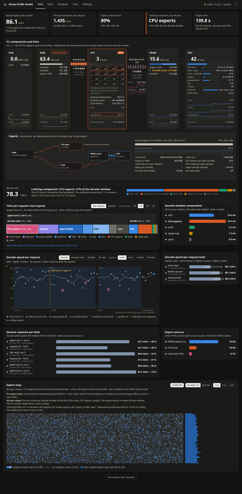

# Strata Profile Studio

Strata Profile Studio is a profiling and tuning tool for [Strata](https://github.com/Niko1221/Strata). It runs next to
Strata on the same PC and shows:
- the limiting component of the PC, live.
- the time per request, split per phase and per decode window part.
- the change between runs, against the noise floor of this PC.
- the calibration of a tune, and its result on the requests that you send.

The Studio needs only Python 3. The server uses the standard library only. The page is plain JavaScript and loads no
library.


| Runs | Compare | Tune |
| --- | --- | --- |
|  |  |  |
| **Request** | **Settings** | **Dark theme** |
|  |  |  |

The screenshots show the real data of one PC (RTX 5070 Ti, Ryzen 7 5800X3D, Swift 1.5 IQ3_S) on 2026-10-15.
`docs/screenshots/` has each view in light, dark and at 390 px. It also has each state, for example "Strata does not
answer", "profiling off" and "a tune started on the page of Strata".

## Glossary

The page and this file use these terms, and only these terms, for these things.

| Term | Meaning |
| --- | --- |
| decode | The engine generates the answer, one token or more per decode window. Decode speed is in tok/s. |
| prompt read | The engine reads the prompt into the KV cache before the decode. Prompt read speed is in tok/s. |
| decode window | One step of the decode: the draft proposes tokens and the model accepts some of them. Its time (ms per window) splits into GPU, CPU experts, draft, adapt wait and other. |
| expert cache | The experts that the GPU keeps in VRAM (`--expert-cache`). The engine fills it in the order of the expert profile. |
| hit rate | The share of the expert lookups that the expert cache serves. |
| PCIe share | The share of the routed experts that the GPU reads over PCIe instead of the CPU pool (`--pcie-frac`). |
| CPU pool | The CPU threads that compute the experts that are not in VRAM (`--pool-workers`). |
| calibration | Strata's `tools/calibrate.py`. It measures the PCIe share, the draft floor, the CPU workers and the expert tier. It keeps a value only when the value beats the default by more than 3 %. |
| profile run | One run of Strata's `tools/strata_profile.py`: 16 requests and a report in `bench/results`. |
| run | The report of one profile run (for example: run 5). |
| tune | The Studio's flow: profile run before, calibration, model load, profile run after, comparison. |
| baseline | The newest run that used the engine defaults for every calibrated setting. |
| noise floor | The largest difference between runs with the same settings, per metric, and never less than 3 %. A change counts only when it is larger. |
| settings layers | The three values of a setting. Loaded now: the engine uses it now. Next load: the next model load uses it. Config file: the run config file has it. |

## Requirements

- Linux, Python 3.11 or newer, and a browser. The Studio may work on other systems. Only Linux has tests.
- Strata on the same PC.
- Strata needs `"profile": true` in `strata-<model>.json` (or `serve/server.py --profile`) for these parts: the time
  per request on Now, **Run a profile** and **Tune**. Without it, Now shows speeds only.
- **Runs**, **Compare** and the settings file work without profiling, and also when Strata does not run. The page
  shows the state of Strata and the action to take.

## Start

```
python3 studio.py --strata http://127.0.0.1:8080 --results ~/Strata/bench/results
```

Also give the run config. The Settings page needs it for its edits. The engine log next to the run config gives the
PC module its measured PCIe ceiling:

```
python3 studio.py --strata http://127.0.0.1:8080 --results ~/Strata/bench/results \
    --config ~/Strata/strata-swift-iq3_s.json
```

Then open <http://127.0.0.1:8090>. When Strata has an API key, give the key in the environment, not on the command
line:

```
STRATA_KEY=... python3 studio.py --strata http://127.0.0.1:8080 --results ~/Strata/bench/results
```

The Studio prints `Strata Profile Studio on http://127.0.0.1:8090/ (Strata: ..., reports: ...)`. It runs until you
press Ctrl-C. When you close the browser tab, nothing stops. The polls and a running tune are in `studio.py`.

### Flags

| Flag | Default | Meaning |
| --- | --- | --- |
| `--strata URL` | `http://127.0.0.1:8080` | Where Strata answers. |
| `--results DIR` | `~/Strata/bench/results` | Strata's `bench/results` folder. The Studio reads the profile reports from it. |
| `--key KEY` | `$STRATA_KEY` | Strata's API key. Prefer the environment variable: it stays out of `ps`. |
| `--port N` | `8090` | The Studio's port. |
| `--host ADDR` | `127.0.0.1` | The address to listen on. Anything but `127.0.0.1`, `::1` or `localhost` needs a key. |
| `--allow-host HOST[:PORT]` | none | The Studio also answers to this `Host` name (you can give the flag more than once). It still listens on `--host` only. Use it for a reverse proxy (see below). A name without a port allows each port. |
| `--config PATH` | none | Strata's `strata-<model>.json`. The Settings page shows its values. The Studio writes it only after a dialog on the Settings page, and keeps a `.bak` copy first. |
| `--engine-log PATH` | the config's `"log"`, else `strata-<model>.log` next to it | Strata's engine log, read only, the tail only. The PC module reads the PCIe probe line (the measured link and CPU pool speeds) and the CPUs of the pool workers. |
| `--read-only` | off | The Studio starts no profile run and no tune, and writes no file. Every POST answers 403. Use it to show the Studio to other persons. |
| `--state PATH` | `studio-state.json` next to `studio.py` | The Studio's own file (tune records, notes). |
| `--version` | | Print the version. |

## The views

Each view starts with a row of headline numbers. Each chart has a noun-phrase title and says if higher or lower is
better. Tables are in the detail views and behind **All numbers**.

**Now: speed, time per request, limiting component, trend.**
- **PC components and links.** Disk, RAM, CPU, PCIe, VRAM and GPU in one row, with the links between them.
  - Each block shows its main value, a use bar, figures and 2 to 4 sparklines of the last 60 s.
  - The CPU block shows each logical CPU (busy %, frequency). It marks the pool-worker CPUs and the host CPU from
    the engine log.
  - The GPU block shows data from `nvidia-smi`: the SM and memory clocks against their maximum, and the memory
    controller. It also shows the power against its limit, the temperature, the fan, the P-state, the PCIe link and
    the clock limit reasons.
  - The block with the largest share of the last decode window has the **limit** mark.
  - The **experts** panel shows the expert flow in four paths. RAM to the CPU pool: computed. RAM over PCIe to the
    GPU: read over PCIe. RAM over PCIe to the VRAM cache: swapped in. VRAM cache to the GPU: cache hits. The path widths are the shares of the
    last decode window. The pulses move while a decode runs.
- **Time per request.** An icicle of the last request, or of the window: the prompt read per phase and the decode
  per window part. The widest block is the largest cost.
- **Decode speed per request.** A scatter against order, clock, context size or hit rate. It shows profile runs as
  bands, outliers per kind, and the calibration's own requests as hollow marks. The calibration's requests are not in
  any statistic.
- **Expert map.** One cell per expert: 48 layers x 512 experts, coloured by the rank in the expert profile. Blue cells
  are the experts that the engine loads into the VRAM cache at the start. With a learned profile
  (`expert_profile_save`), the map shows the experts that entered or left the cache between two saves. The map uses
  the profile files only. The engine reports no expert ids per window.
- All parts of Now change in place. The page test records 30 s of updates. In that time, the page adds and removes no
  node, and no layout box moves.

**Request (the panel).** Select a request on any page. The panel shows:
- a timeline of the request: the prompt read per phase, then the decode per window.
- the expert sources, the KV reads and the drafts.
- the prompt read phases.
- the same request in the other runs.

**Runs: each report as an experiment.**
- Decode and prompt read speed per run.
- The noise between runs with the same settings.
- A table of all runs.
- One run: time per request, decode window composition, the report findings, settings, environment, a note and
  **Save as image**.

**Compare: any set of runs against a reference.**
- The **baseline** is always present: the newest run with the engine defaults. Without a baseline, **Run a profile
  with the engine defaults** makes one (see below).
- Select the runs: add a run, **All runs**, **Last settings change** (the two runs around the newest settings change),
  or **Tune before and after**. The reference is the baseline or any selected run.
- Charts:
  - decode speed per workload and prompt read speed per prompt size, with the noise band of the reference.
  - the change against the reference (a forest plot, with the sign test of the agent turns).
  - decode speed per agent turn.
  - the settings matrix (differences from the reference and engine defaults have a mark).
  - the decode window composition per run.
- With exactly two runs, the page also shows the two-run comparison. It has sentences, the sign test, the window
  change, the settings difference and the noise floor sources.
- Compare reads only the reports on disk. It works while a tune runs.

**Tune: the tune in detail.**
- **Tune this PC** runs a profile, the calibration, a model load, a second profile and the comparison. **The
  calibration unloads the model. Strata answers requests with 503 until the calibration ends.** The dialog says
  so.
- The **tune flow timeline**: each stage on one time axis, the stage durations, and the newest output.
- **Calibration measurements in order**: each measurement as the calibration made it, with the engine starts. Round 2
  of a sweep runs in reverse order.
- The **calibration log**, with a filter.
- One chart per setting. It shows each round as a line, the median, the kept value and the value before the tune. It
  also shows the best value when the calibration did not keep it.
- **Calibration objective against your workloads**: the calibration measures 128-token decodes (512 tokens for the
  expert tier) of 3 short chat prompts. It does not measure prompt reads, long-context decode or agent turns.
- **Tune result per workload**: the calibration's own measure against the profile before and after. It shows the
  noise floor, the sign test, and a forest plot per agent turn and prompt read.
- Two buttons: **Keep the tuned settings** and **Use the settings of run X**.
- **Tune history** with the calibration rate per tune.

**Settings: three layers and the engine default, editable.**
- Each setting shows the value loaded now, at the next load, in the run config file, and the engine default. A ⚠
  mark shows layers with different values.
- Each row has a control for the file value:
  - A slider where the engine states a range.
  - A number field where the engine states no range. The hint says so.
  - The special values `auto` and `default` where the engine accepts them.
  - **Reset**.
- **Reset all to the engine defaults** stages a reset of each row.
- The edits go into an edit list. **Write the edits** writes them after a dialog, with a `.bak` copy.
- **Settings of a run** writes the values of one run into the file in the same way.

## How the comparison decides

A change counts only when it is larger than the noise floor of this PC.
- Two reports with the same settings differ only by noise. "The same settings" means the same PCIe share, draft
  floor, CPU workers and expert tier, on the same GPU, model, quant and context.
- For each metric, the noise floor is the largest difference between such reports on disk. It is never less than
  3 % (`MIN_GAIN` of calibrate.py).
- The result says where the floor comes from, for example "noise floor from runs 3 and 4, same settings".
- Without two such reports, the Studio uses fixed floors. The values are 5 % for a speed, 1 ms for a window part
  and 2 points for a hit rate. The result then says "assumed floor". To measure the floors, run the profile two
  times with the same settings.
- The three chat questions of one report are three different prompts. The Studio does not use their spread as noise.
- The sign test: 5 or more agent turns can all move in the same direction. Then the result says so, for example "6 of
  6 agent turns slower". The page gives the exact two-sided p (6 of 6 turns: 1 in 32). A sign test can show a small
  real change also when each turn stays inside its noise floor.

## What the Studio writes, and what it never touches

**`studio-state.json`** (and its `.tmp` and `.bad` copies): tune records, notes, and the settings of runs that
record none.

**The run config file (`--config`).** The Studio writes it only after a dialog, from **Write the edits** or
**Settings of a run** on the Settings page.
- Only the selected settings change in `"args"`, `"env"` or the top-level key. A reset removes the value, so the
  engine default applies.
- All other keys and arguments stay the same. The file keeps its indentation.
- The Studio copies the file to `<file>.bak` first. It replaces an older `.bak`.
- The Studio refuses the write in these cases:
  - while a tune runs (Strata writes the file when a tune ends).
  - when the file changed after the page read it (the sha256 of the file differs).
  - without `--config`.
  - with `--read-only`.
- **Strata reads the file at its next start.** The running engine keeps its settings until then.

**Run a profile with the engine defaults** (Compare page) writes no Strata file.
- It writes a copy of the run config without the calibrated settings into a temporary folder of the Studio.
- It unloads Strata's model through Strata's own `POST /unload`.
- It starts Strata's `tools/strata_profile.py` with that copy on a free port. The report goes to the results folder.
- It removes the copy when the run ends.
- A request to Strata during the run loads the model again. Then the run fails.

**What the Studio only reads:** the results folder, the engine log, the expert profiles, `/proc`, `/sys`,
`nvidia-smi`, and Strata's routes.

**What changes Strata's settings:** `POST /profile/tune`, Strata's own route, which **Tune this PC** calls, and the
file writes above.

## Security

- The Studio listens on `127.0.0.1` only. With another `--host` address, it does not start without `--key`. Then each
  `/api/` request must send `Authorization: Bearer <key>`. The page asks for the key and keeps it in
  `sessionStorage`.
- The key is only in the memory of the process. It is never in a response, the page, the state file or a log line.
- The `Host` header must be an address of the Studio (protection against DNS rebinding).
- A POST needs `Content-Type: application/json`, at most 64 KiB and no foreign `Origin`. Thus a web page on another
  site cannot start a tune through the Studio.
- The page has the Content-Security-Policy `script-src 'self'`. It never uses `innerHTML` (a test asserts this). It
  writes text with `textContent`. The page loads nothing from outside the PC.
- The Studio calls a fixed list of Strata routes. It never sends a path from the page to Strata.

### Behind a reverse proxy (tailscale serve)

The Studio still listens on `127.0.0.1`, and the proxy connects to it there. `--allow-host` lets the name of the proxy
pass the `Host` check. With tailscale:

```
python3 studio.py --strata http://127.0.0.1:8080 --results ~/Strata/bench/results \
    --config ~/Strata/strata-swift-iq3_s.json --allow-host ub01.char-logarithm.ts.net:8444
tailscale serve --bg --https=8444 http://127.0.0.1:8090
```

Then open `https://ub01.char-logarithm.ts.net:8444/`.
- A page over HTTPS sends `Origin: https://<that name>`. The Studio accepts it only for the names of `--allow-host`.
- Each person who can open that address can use the Studio. This includes a tune and a write of the run config.
- With `--key`, each `/api/` request needs the key. The page asks for it.
- With `--read-only`, other persons can look at the Studio, but they cannot start or write anything.

## Tests

```
python3 -m unittest discover -s tests
```

**The unit tests** need no Strata, no GPU and no network. They take about 20 s. `tests/fakestrata.py` is an
in-process replacement for the routes of Strata. The parser tests use real lines and files from the development PC
(`tests/fixtures/host`: `/proc/stat`, `nvidia-smi`, the engine log, the header of the expert profile).

**The page check** opens each view and each state in headless Chromium against `tests/demo_strata.py`. The demo
Strata replays recorded data: real reports, live samples, the `/metrics` hardware and the output of a real
calibration. Run the page check with a Python that has Playwright:

```
<venv>/bin/python tests/page_check.py                 # fixture reports, screenshots into docs/screenshots
<venv>/bin/python tests/page_check.py --seed ~/Strata/bench/results --live live.json --hardware hardware.json \
    --settings settings.json --tunes studio-state.json --config strata-x.json   # copies of real data
```

The page check prints one PASS or FAIL line per check:
- No script error.
- no horizontal scroll at 390 px.
- No flicker: in 30 s of live updates, the page adds and removes no node in the live regions of Now. The layout
  boxes 1 s apart are the same (`flicker-proof.json`, `flicker-t0.png`, `flicker-t1.png`).
- the PC module readings move, and a component has the limit mark.
- **Run a profile** and **Tune this PC** work from their buttons, and the tune ends with "succeeded".
- an edit on the Settings page goes into the edit list, and a write leaves a `.bak` copy.
- each state shows its message.

The page check never connects to port 8080 and never writes a real Strata file.

**Use the Studio without a GPU:**

```
python3 tests/demo_strata.py --port 8195 --results /tmp/demo-results --state decoding
python3 studio.py --strata http://127.0.0.1:8195 --results /tmp/demo-results --port 8196
```

## Third-party code

The page loads no library. All charts are hand-written SVG, HTML and canvas. Thus the dark theme needs no redraw,
and the live parts change attributes only.

The repository keeps [Chart.js](https://www.chartjs.org/) **4.4.1** (MIT) at `web/vendor/chart-4.4.1.umd.js`, the
same bytes as `https://cdn.jsdelivr.net/npm/chart.js@4.4.1/dist/chart.umd.js`.
- Its SHA-256 is `74401d738dd3e03ee5dfb3b6841210fe2c4ead8a960c4011ca4ba0b78a9fd8f3`. `web/vendor/README.md` records
  it, and a test asserts it.
- Its licence is in `web/vendor/LICENSE-chart.js.md`.

## Where the design comes from

| Source | Pattern in the Studio |
| --- | --- |
| Chrome DevTools Performance panel, speedscope | The icicle of the time per request, and the order overview, request, details. |
| Nsight Systems | The request on one time axis, and the tune stages on one time axis. |
| Grafana | Headline numbers with a delta, run and tune bands on time axes, sparklines per reading. |
| Optuna slice plots | One chart per calibrated setting, with the rounds and the median. |
| Weights & Biases | The runs table, the run picker and the settings matrix of Compare. |
| Forest plots of benchmark comparisons | The change against the noise band. |
| artificialanalysis.ai, ModelDock | Grouped and ranked bars with the value at the end, distributions for noise, the headline row, the share card. |

## Licence

MIT, Copyright (c) 2026 qiuzan2001. See `LICENSE`. Chart.js is MIT as well.
