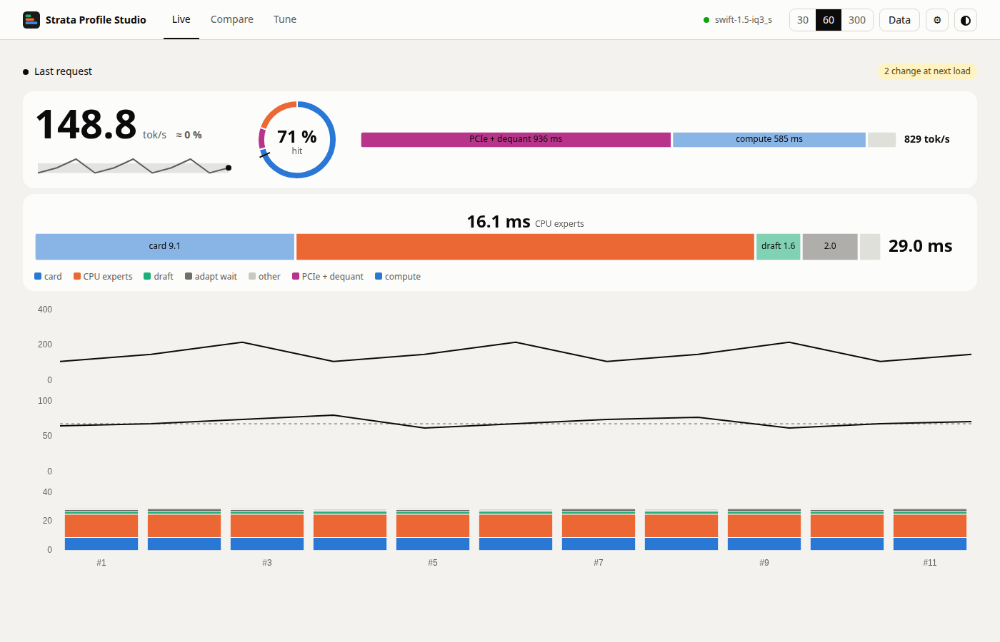
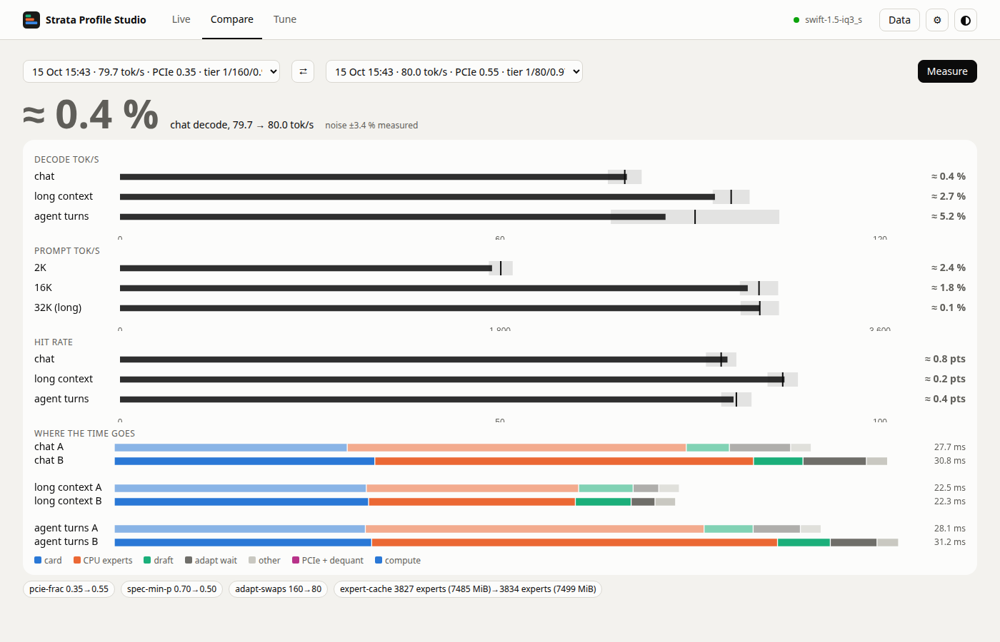
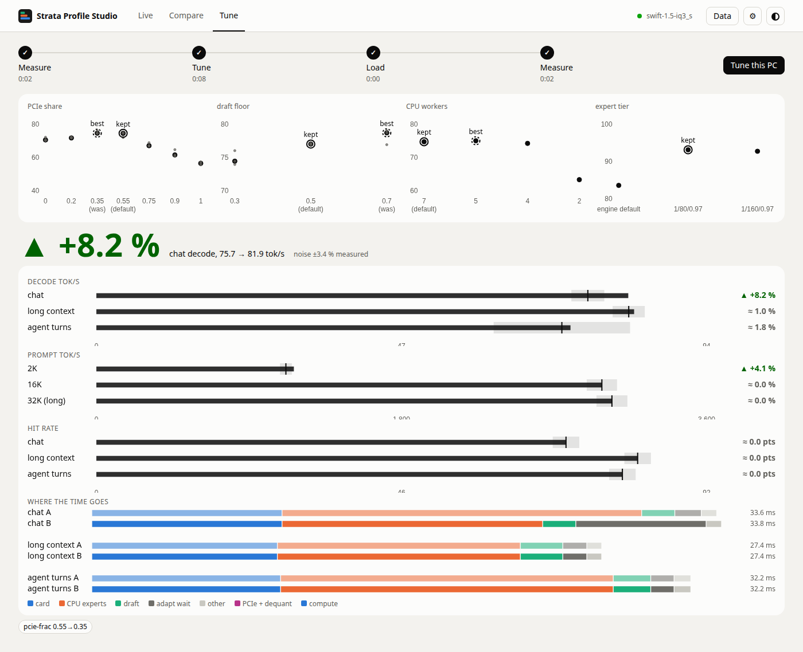
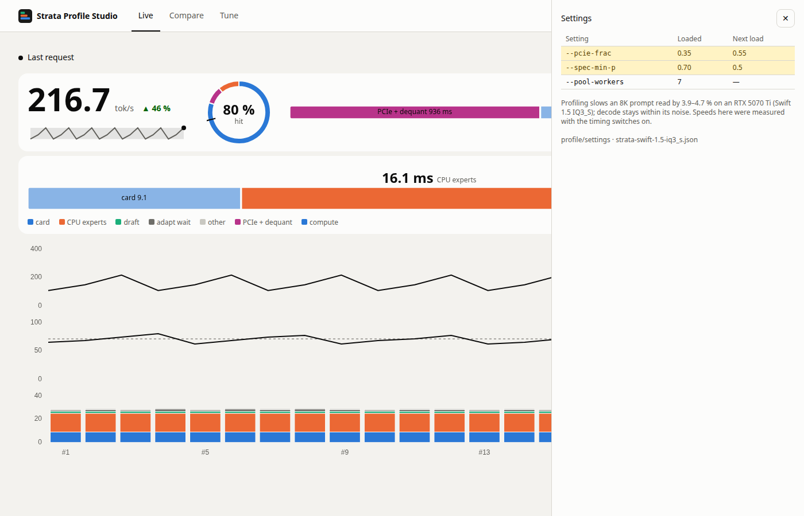

# Strata Profile Studio

A profiling and tuning dashboard for [Strata](https://github.com/Niko1221/Strata): charts for where the time goes on
this PC, one-click profile and tune, and a before/after comparison of a tune. It runs next to Strata on the same PC and
needs nothing installed beyond Python 3: the server is the Python standard library, and the page's one library
(Chart.js) is included in the repository.

It exists to answer questions such as *"the calibration measured 96.6 tok/s against 87, but the first short request
after it showed 7 ms of adapt wait per window against 1.4 ms before. Did the tune help?"* The comparison view settles
that with the profile tool's own numbers, and says whether a change is larger than this PC's run-to-run noise.

| Live | Compare |
| --- | --- |
|  |  |
| **Tune** | **Settings drawer** |
|  |  |

On a phone (390 px wide) and in the dark theme the same views look like `docs/screenshots/live-phone-dark.png`,
`compare-phone-light.png` and so on: every view exists at both widths in both themes.

## Requirements

- Linux, Python 3.11 or newer, and a browser. (It may work on other systems; only Linux is tested.)
- Strata, running on the same PC. For **Live**, **Run a profile** and **Tune** it needs `"profile": true` in
  `strata-<model>.json` (or `serve/server.py --profile`). **Compare** (and the settings drawer) work without that,
  and without Strata running at all.

## Start

```
python3 studio.py --strata http://127.0.0.1:8080 --results ~/Strata/bench/results
```

Then open <http://127.0.0.1:8090>. When Strata has an API key, give it without putting it on the command line:

```
STRATA_KEY=... python3 studio.py --strata http://127.0.0.1:8080 --results ~/Strata/bench/results
```

The Studio prints `Strata Profile Studio on http://127.0.0.1:8090/ (Strata: ..., reports: ...)` and keeps running until
you press Ctrl-C. Closing the browser tab does not stop anything: the polling and a running tune live in `studio.py`.

### Flags

| Flag | Default | Meaning |
| --- | --- | --- |
| `--strata URL` | `http://127.0.0.1:8080` | Where Strata answers. |
| `--results DIR` | `~/Strata/bench/results` | Strata's `bench/results` folder: profile reports are read from here. |
| `--key KEY` | `$STRATA_KEY` | Strata's API key. Prefer the environment variable: it stays out of `ps`. |
| `--port N` | `8090` | The Studio's port. |
| `--host ADDR` | `127.0.0.1` | The address to listen on. Anything but `127.0.0.1`, `::1` or `localhost` needs a key. |
| `--allow-host HOST[:PORT]` | none | Also answer to this `Host` name (repeatable) while still listening on `--host` only: for a reverse proxy, see below. A name without a port allows any port. |
| `--config PATH` | none | Strata's `strata-<model>.json`, opened read only: the Settings view shows its values. |
| `--state PATH` | `studio-state.json` next to `studio.py` | The Studio's one file (tune records, notes). |
| `--version` | | Print the version. |

## The views

Three tabs, one question each, one picture each. Every number that is not in the picture is behind the **Data**
button of that view (tables, with CSV and JSON downloads); the speed settings are in the **⚙ drawer**.

**Live.** *How fast is it, and where does the time go?* The newest decode speed as the big number with its change
against the recent median and a sparkline; a ring of where the experts came from (card cache, PCIe, CPU) with a tick
at the median hit rate; one bar for the decode window (card, CPU experts, draft, adapt wait, other; the biggest
part is named above it) and one for the prompt read (PCIe + dequant, compute, other); then three small charts on
one x: decode speed, hit rate and the window split of each request. The 30/60/300 switch sets how many requests.

**Compare.** *Did it get faster, by how much, where?* Two reports (any two in the results folder; with one, just that
one) as one headline number, one row per metric (the bar is B, the tick is A, the shaded band is the noise floor,
dashed when assumed), A over B bars of the decode window, and a chip per setting that differs. **Measure** runs
Strata's profile and the new report appears in the pickers.

**Tune.** *Where is the tune, and what did it pick?* A four-step line (Measure, Tune, Load, Measure) with the time of
each step, the candidates the calibration measured as four dot plots (grey dots are rounds, the black dot the
median, the ring the value the tune kept, a dashed ring the sweep's best when it was not kept), and the comparison
of the before and after profile opened right under it. **The model is unloaded for the whole calibration** (setup
says 15-30 minutes) and Strata's requests get 503 meanwhile; the page asks you to confirm.

## How the comparison decides

A change counts only when it is larger than the noise of this PC, and the noise is **measured**, not assumed, whenever
the results folder allows it. Two reports made with the same settings (the same PCIe share, draft floor, workers and
expert tier, and the same GPU, model, quant and context) differ from each other only by noise; for each metric (per
kind of request) the floor is the largest such difference found on disk, never less than 3% (calibrate.py's own
`MIN_GAIN`). The verdict says where it came from ("noise floor from runs 3 and 4, same settings"). With no
same-settings pair yet, the floors are fixed guesses (5% for speeds, 1 ms for a window part, 2 points for a hit rate)
and the verdict says "(assumed floor, no same-settings pair measured yet)": run the profile twice with one setting to
measure it. The three chat questions of one report are three different prompts, so their spread is never used. When
at least five agent turns all move the same way, the verdict says so ("6 of 6 agent turns slower"), a sign test that
can show a small real change even where each turn is inside its floor.

## What the Studio writes, and what it never touches

It writes one file, `studio-state.json` (and its `.tmp` and `.bad` siblings): tune records, notes and the settings
captured for reports that record none. It never writes Strata's files, its config or its results folder; `--config`
and the report folders are only opened for reading. The only thing it does that changes Strata's run config is
`POST /profile/tune`, Strata's own route, which is what *Tune this PC* calls. It does not start, stop or reload Strata,
except for the one short chat request that loads the model again after a tune.

## Security

- It listens on `127.0.0.1` only. `--host` with any other address refuses to start without `--key`, and then every
  `/api/` request must carry `Authorization: Bearer <key>` (the page asks for it and keeps it in `sessionStorage`).
- The key lives only in the process's memory. It is never in a response, the page, the state file or a log line.
- `Host` must be one of the Studio's own addresses (DNS rebinding), and a POST needs `Content-Type: application/json`,
  at most 64 KiB and no foreign `Origin`, so a web page elsewhere cannot start a tune through it.
- The page's Content-Security-Policy is `script-src 'self'`; it never uses `innerHTML` (a test greps for it) and
  draws text with `textContent`. Chart.js is vendored, so the page makes no request that leaves the PC.
- The Studio calls a fixed list of Strata routes and never forwards a path the page names.

### Behind a reverse proxy (tailscale serve)

The Studio keeps listening on `127.0.0.1`; the proxy reaches it there, and `--allow-host` lets the proxy's name
through the Host check (which is otherwise strict). With tailscale:

```
python3 studio.py --strata http://127.0.0.1:8080 --results ~/Strata/bench/results \
    --allow-host ub01.char-logarithm.ts.net:8444
tailscale serve --bg --https=8444 http://127.0.0.1:8090
```

Then open `https://ub01.char-logarithm.ts.net:8444/`. A page served over HTTPS sends `Origin: https://<that name>`,
which the Studio accepts only for names given with `--allow-host`. Everyone who can reach that address can use the
Studio, including starting a tune: with `--key` given, every `/api/` request needs it (the page asks for it).

## Tests

```
python3 -m unittest discover -s tests
```

They need no Strata, no GPU and no network, and finish in well under 30 seconds. `tests/fakestrata.py` is an in-process
stand-in for Strata's routes; it can also be run by hand to try the Studio with no GPU:

```
python3 tests/fakestrata.py --port 8191 --results /tmp/results --settings --history
python3 studio.py --strata http://127.0.0.1:8191 --results /tmp/results --port 8192
```

## Third-party code

- [Chart.js](https://www.chartjs.org/) **4.4.1**, MIT licence, vendored byte for byte at
  `web/vendor/chart-4.4.1.umd.js` from `https://cdn.jsdelivr.net/npm/chart.js@4.4.1/dist/chart.umd.js`
  (SHA-256 `74401d738dd3e03ee5dfb3b6841210fe2c4ead8a960c4011ca4ba0b78a9fd8f3`; recorded in `web/vendor/README.md`
  and checked by a test). Its licence is in `web/vendor/LICENSE-chart.js.md`.

## Licence

MIT, Copyright (c) 2026 qiuzan2001. See `LICENSE`. Chart.js is MIT as well.
