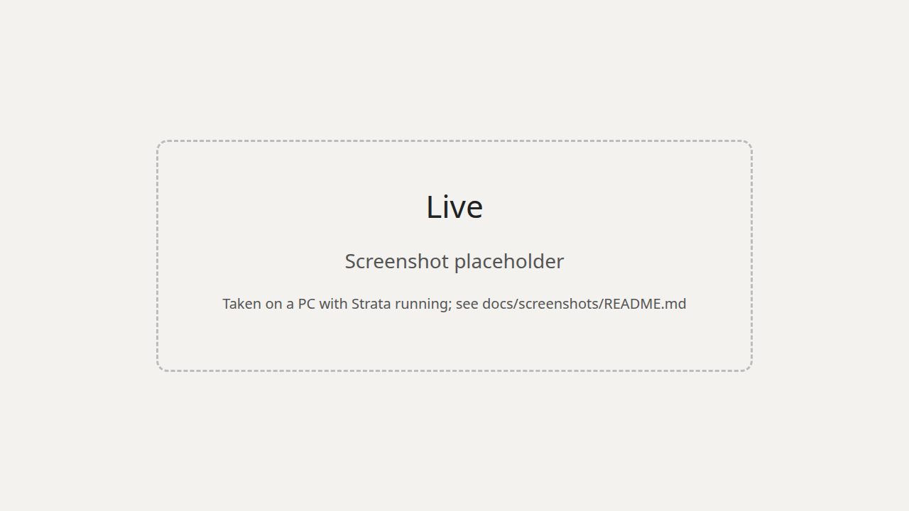
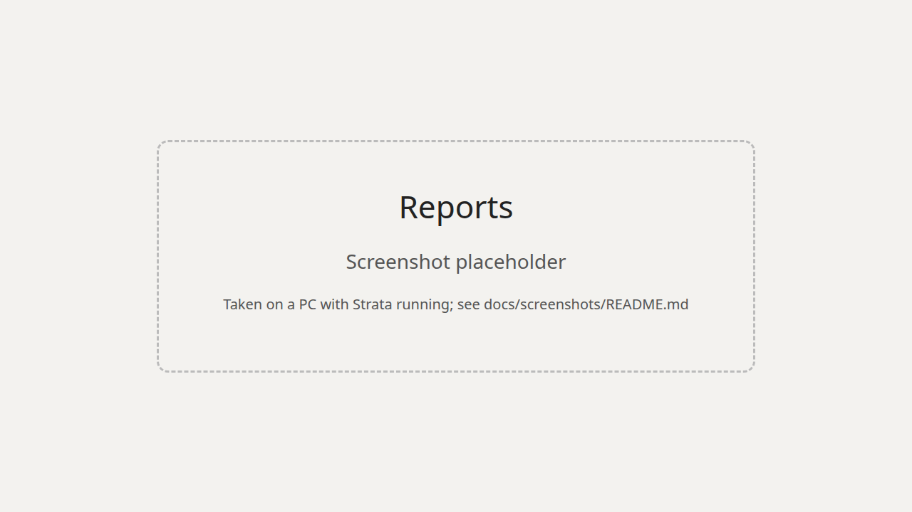

# Strata Profile Studio

A profiling and tuning dashboard for [Strata](https://github.com/Niko1221/Strata): charts for where the time goes on
this PC, one-click profile and tune, and a before/after comparison of a tune. It runs next to Strata on the same PC and
needs nothing installed beyond Python 3: the server is the Python standard library, and the page's one library
(Chart.js) is included in the repository.

It exists to answer questions such as *"the calibration measured 96.6 tok/s against 87, but the first short request
after it showed 7 ms of adapt wait per window against 1.4 ms before. Did the tune help?"* The comparison view settles
that with the profile tool's own numbers, and says whether a change is larger than this PC's run-to-run noise.

| Live | Reports |
| --- | --- |
|  |  |
| **Compare** | **Tune** |
|  |  |
| **Settings** | |
|  | |

*The images above are placeholders until real screenshots are taken on a PC with Strata running.*

## Requirements

- Linux, Python 3.11 or newer, and a browser. (It may work on other systems; only Linux is tested.)
- Strata, running on the same PC. For **Live**, **Run a profile** and **Tune** it needs `"profile": true` in
  `strata-<model>.json` (or `serve/server.py --profile`). **Reports**, **Compare** and **Settings** work without that,
  and without Strata running at all.

## Start

```
python3 studio.py --strata http://127.0.0.1:8080 --results ~/Strata/bench/results
```

Then open <http://127.0.0.1:8090>. When Strata has an API key, give it without putting it on the command line:

```
STRATA_KEY=... python3 studio.py --strata http://127.0.0.1:8080 --results ~/Strata/bench/results
```

The Studio prints `Strata Profile Studio on http://127.0.0.1:8090/ (Strata: ..., reports: ...)` and keeps running until
you press Ctrl-C. Closing the browser tab does not stop anything: the polling and a running tune live in `studio.py`.

### Flags

| Flag | Default | Meaning |
| --- | --- | --- |
| `--strata URL` | `http://127.0.0.1:8080` | Where Strata answers. |
| `--results DIR` | `~/Strata/bench/results` | Strata's `bench/results` folder: profile reports are read from here. |
| `--key KEY` | `$STRATA_KEY` | Strata's API key. Prefer the environment variable: it stays out of `ps`. |
| `--port N` | `8090` | The Studio's port. |
| `--host ADDR` | `127.0.0.1` | The address to listen on. Anything but `127.0.0.1`, `::1` or `localhost` needs a key. |
| `--config PATH` | none | Strata's `strata-<model>.json`, opened read only: the Settings view shows its values. |
| `--state PATH` | `studio-state.json` next to `studio.py` | The Studio's one file (tune records, notes). |
| `--version` | | Print the version. |

## The views

**Live.** Each request's breakdown as it happens, from Strata's `/profile/last` (and `/profile/history`, so requests
that came closer together than a second still appear). Four tiles (last decode speed, expert cache hit rate, last
prompt read, ms per window) and four charts: decode speed coloured by context size, hit rate, the decode window split
into GPU, CPU experts, draft, adapt wait and other, and the prompt read split by phase. A table lists the last 20
requests. With profiling off, speed and hit rate still come from `/metrics`; the window and phase charts need profiling.

**Reports.** Every profile report in `--results`, newest first, drawn as charts: the prompt phases (R1), the decode
window per kind of request (R2), and the agent session turn by turn (R3a hit rate, R3b decode speed), with the
settings the report ran with, its findings and a note you can keep. *Run a profile* starts Strata's own run and shows
its output. Check two reports and *Compare these two* opens them side by side.

**Compare.** Two reports with a verdict per kind of request ("chat: 8.2% faster, 75.7 → 81.9 tok/s (noise floor
4.6%); largest change: adapt wait +5.6 ms per window"), four charts, every number with its change, and the settings
that differ. Changes carry ▲, ▼ or ● as well as colour.

**Tune.** One click: profile, Strata's calibration, load the model again with one short request, profile again,
compare. Six stages with ticking times and the calibration's output; four dot charts show every candidate the
calibration measured and which one it kept; the result card shows the speed, the first request after the tune and
the settings before and after. **The model is unloaded for the whole calibration** (setup says 15–30 minutes) and
Strata's requests get 503 meanwhile; the page asks you to confirm. A past-tunes list keeps the records.

**Settings.** The speed settings with what each does, the value loaded now, the value the next load will use and the
run config's value, from Strata's `/profile/settings` when it has it, otherwise from `/metrics`, otherwise from
`--config`. The Studio shows them; it does not edit them.

## How the comparison decides

Every profile report repeats the same three chat questions, so their spread is the run-to-run noise of a decode on
this PC and build. For a report, that spread is `(max − min) / median` of the three chat decode speeds, and for the
hit rate it is `max − min`. A change counts only when it is larger than the noise allows: for medians of several runs
the bigger of 3% and the two reports' spreads, for single runs (long context, prompt reads, agent turns) the bigger
of 5% and 1.7 times the spread, and for a window part also more than 0.5 ms. Everything inside that is reported as
"no measurable change", whatever its sign. The 3% is calibrate.py's own `MIN_GAIN`; the 1.7 comes from range being
about 1.7 standard deviations of three samples, and a difference of two single runs being real at two standard
deviations of the difference.

## What the Studio writes, and what it never touches

It writes one file, `studio-state.json` (and its `.tmp` and `.bad` siblings): tune records, notes and the settings
captured for reports that record none. It never writes Strata's files, its config or its results folder; `--config`
and the report folders are only opened for reading. The only thing it does that changes Strata's run config is
`POST /profile/tune`, Strata's own route, which is what *Tune this PC* calls. It does not start, stop or reload Strata,
except for the one short chat request that loads the model again after a tune.

## Security

- It listens on `127.0.0.1` only. `--host` with any other address refuses to start without `--key`, and then every
  `/api/` request must carry `Authorization: Bearer <key>` (the page asks for it and keeps it in `sessionStorage`).
- The key lives only in the process's memory. It is never in a response, the page, the state file or a log line.
- `Host` must be one of the Studio's own addresses (DNS rebinding), and a POST needs `Content-Type: application/json`,
  at most 64 KiB and no foreign `Origin`, so a web page elsewhere cannot start a tune through it.
- The page's Content-Security-Policy is `script-src 'self'`; it never uses `innerHTML` (a test greps for it) and
  draws text with `textContent`. Chart.js is vendored, so the page makes no request that leaves the PC.
- The Studio calls a fixed list of Strata routes and never forwards a path the page names.

## Tests

```
python3 -m unittest discover -s tests
```

They need no Strata, no GPU and no network, and finish in well under 30 seconds. `tests/fakestrata.py` is an in-process
stand-in for Strata's routes; it can also be run by hand to try the Studio with no GPU:

```
python3 tests/fakestrata.py --port 8191 --results /tmp/results --settings --history
python3 studio.py --strata http://127.0.0.1:8191 --results /tmp/results --port 8192
```

## Third-party code

- [Chart.js](https://www.chartjs.org/) **4.4.1**, MIT licence, vendored byte for byte at
  `web/vendor/chart-4.4.1.umd.js` from `https://cdn.jsdelivr.net/npm/chart.js@4.4.1/dist/chart.umd.js`
  (SHA-256 `74401d738dd3e03ee5dfb3b6841210fe2c4ead8a960c4011ca4ba0b78a9fd8f3`; recorded in `web/vendor/README.md`
  and checked by a test). Its licence is in `web/vendor/LICENSE-chart.js.md`.

## Licence

MIT, Copyright (c) 2026 qiuzan2001. See `LICENSE`. Chart.js is MIT as well.
